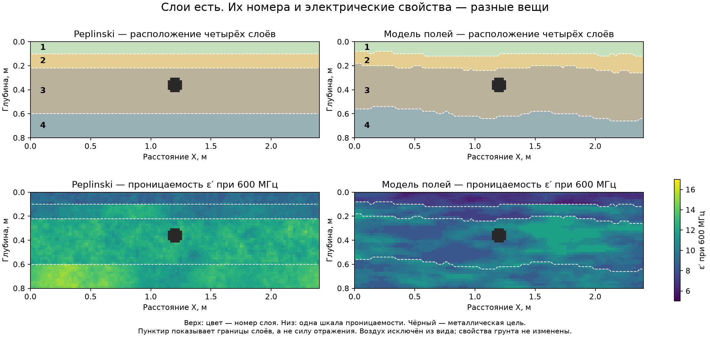
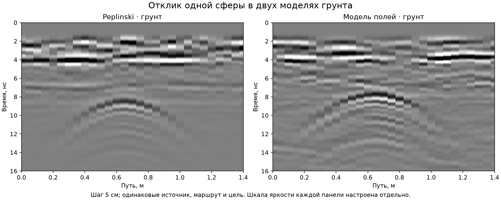

# GeoDataGen

**Неоднородный грунт → объекты → маршрут → A- и B-сканы.**

GeoDataGen подготавливает трёхмерные сцены, запускает расчёт в gprMax и сохраняет весь эксперимент в одной папке. Грунт можно построить штатным способом Peplinski или моделью полей CRIM/Archie. Объекты, влажность, слои, источник и маршрут задаются в JSON.

[Документация с рисунками](https://bysaf.github.io/geodatagen/) · [Готовые данные](https://github.com/bySaf/geodatagen/releases/tag/v1.0.0) · [Источники и атрибуция](THIRD_PARTY_NOTICES.md)



## Скачать и запустить

Нужен **Python 3.12**. Поддерживаемый путь установки: macOS и Linux; на Windows — WSL2 с Linux Python. Подойдёт также Python 3.13, но контрольная установка выполнена на 3.12. Для готового бинарного пакета gprMax компилятор не нужен. ParaView устанавливается отдельно и не требуется для расчёта.

```bash
git clone https://github.com/bySaf/geodatagen.git
cd geodatagen
bash scripts/setup.sh
source .venv/bin/activate
python geodatagen.py docs
```

Последняя команда открывает локальную документацию. Её можно открыть и без Python: `user_review/index.html`. Интернет для просмотра скачанной документации не нужен.

### Интерпретатор PyCharm

Откройте **корень `geodatagen`**. После установки окружения:

1. Откройте Settings (`⌘,` на macOS) → **Project Structure**. В других версиях нужная страница называется **Python Interpreter**; её можно найти поиском настроек.
2. В списке Interpreter выберите **Add Interpreter → Add Local Interpreter**.
3. Выберите существующий Python / **Existing environment** и укажите `<папка проекта>/.venv/bin/python`.
4. Примените настройки. Версия выбранного интерпретатора должна быть **3.12 или 3.13**.

Если окружение ещё не создано, сначала выберите Python 3.12 как базовый интерпретатор нового Virtualenv. Системный `/usr/bin/python3` на macOS может оказаться Python 3.9 — он не подходит. [Инструкция JetBrains](https://www.jetbrains.com/help/pycharm/configuring-python-interpreter.html).

Ошибка `No matching distribution found for contourpy==1.4.0` с сообщением `Requires-Python >=3.12` означает несовместимую версию Python. Проверка в терминале: `python --version` и `python -c "import sys; print(sys.executable)"`. Устанавливать пакеты следует в выбранное окружение, а не понижать версии зависимостей.

Встроенный терминал должен находиться в корне проекта. После смены интерпретатора откройте новую вкладку Terminal и выполните `source .venv/bin/activate`.

### Первый короткий расчёт

```bash
python geodatagen.py init first-test --config examples/smoke.json --mode custom_crim_archie
python geodatagen.py run first-test --limit 1
python geodatagen.py status first-test
python geodatagen.py plot first-test
python geodatagen.py docs first-test
```

Это маленькая сцена из трёх позиций для проверки установки. После одной трассы доступен A-скан; полноценный B-скан требует нескольких позиций. Досчитать оставшиеся:

```bash
python geodatagen.py run first-test
python geodatagen.py plot first-test
```

### Собственный эксперимент

Скопируйте `examples/park-objects.json`, измените параметры и выберите новое имя:

```bash
cp examples/park-objects.json examples/my-park.json
python geodatagen.py init park-demo --config examples/my-park.json --mode custom_crim_archie
python geodatagen.py run park-demo --limit 1
python geodatagen.py plot park-demo
```

После проверки геометрии продолжите командой `python geodatagen.py run park-demo`. Для штатного грунта выберите `--mode native_peplinski` и другое имя эксперимента. Полный пример содержит 29 позиций; время расчёта зависит от компьютера и размеров сетки. Готовые демонстрационные результаты уже показаны в документации.

## Одна папка на эксперимент

```text
experiments/park-demo/
├── index.html          # локальная страница этого опыта
├── config.json         # сохранённые параметры расчёта
├── objects.json        # фактические координаты и радиусы
├── positions.npz       # позиции передатчика и приёмника
├── scene/              # сцена, материалы и геометрия
├── run/                # вход решателя и его рабочие файлы
├── bscan.h5            # сигналы, время, позиции, маска готовности
├── scene_layout.png    # маршрут и размещение объектов
├── ascan.png           # сигнал одной рассчитанной позиции
├── bscan.png           # радарограмма готовых позиций
└── …                   # экспорт, журнал и состояние расчёта
```

Часть файлов появляется только после соответствующего шага. `run` продолжает незавершённый расчёт. Изменение настроек требует нового имени, чтобы не смешивать разные сцены. Каталоги `experiments/` и старых расчётов `data/` исключены из Git.

## Как менять сцену

| Что изменить | Параметр |
|---|---|
| Способ генерации грунта | `--mode native_peplinski` или `custom_crim_archie` при `init` |
| Повторяемость случайного грунта | `seed` |
| Слои и влажность | `preset.layers` |
| Объекты | `objects`: `type`, `center_m`, `radius_m` |
| Источник | `source`: форма, частота, высота, расстояние Tx/Rx |
| Путь и шаг измерения | `profile` |
| Размер сцены и сетка | `grid` |

Объекты в простом сценарии — сферы типов `metal`, `air`, `dielectric`. Координаты и размеры задаются в метрах, Z направлена вверх. В парковом примере поверхность находится на `z=0.8`: центр `z=0.45` означает глубину 35 см. В маленьком `smoke.json` поверхность другая — `z=0.5`. Формула глубины всегда `surface_z − z`.

Полная инструкция, пояснения полей и ограничения находятся в [документации](https://bysaf.github.io/geodatagen/).

## Открыть в ParaView

1. Установите [ParaView](https://www.paraview.org/download/) для своей системы.
2. Подготовьте эксперимент, затем выполните `python geodatagen.py export park-demo`.
3. Откройте созданный геометрический файл `.vti` через **File → Open → Apply**. Точный путь команда напечатает в терминале; он находится внутри `experiments/park-demo/`.
4. Выберите поле окраски и **Rescale to Data Range**. Для разреза: **Filters → Slice**, нормаль `[0, 1, 0]`, положение Y по середине сцены, затем **Apply**. При необходимости скройте исходный объём значком глаза.

`.vti` показывает материалы и геометрию. `bscan.h5` хранит сигналы и открывается средствами проекта; `.in` — текстовая постановка для gprMax. Это три разных вида данных. В [локальной инструкции](user_review/index.html) приведены подробные шаги и примеры разрезов.

## Готовые результаты



В репозитории есть исходный код, настройки, документация и готовые рисунки. Большие численные результаты вынесены в [релиз v1.0.0](https://github.com/bySaf/geodatagen/releases/tag/v1.0.0): файл **`geodatagen-datasets-v1.zip`**. Распакуйте его **в корень клона**; появятся `data/final/` и `user_review/realism/pilot/`.

- **4500 A-сканов:** три исходные сцены — парк, поле и дорога; по три маршрута на сцену, штатный грунт Peplinski.
- **58 A-сканов:** новый небольшой парковый опыт, по 29 позиций для каждого из двух генераторов грунта.
- **4 контрольных расчёта:** отдельные проверки цели и поглощающих границ.

Новые эксперименты от архива не зависят. Названия локаций обозначают настраиваемые сценарии, а не измеренные участки.

Реальный пример гиперболы — [измерения GP8800 в армированном бетоне](https://doi.org/10.5281/zenodo.10962520). Он отличается от нашей почвенной сцены материалом, частотной полосой и антенной; совпадение картинок не является оценкой точности прибора. В текущем расчёте используются идеальные Tx/Rx, а не откалиброванная модель конкретного георадара.

## Структура проекта

| Путь | Назначение |
|---|---|
| `geodatagen.py` | Короткие команды работы с экспериментом |
| `examples/` | Готовые настройки для копирования |
| `src/` | Грунт, размещение объектов, расчёт и отчёты |
| `tools/` | Расчётные и проверочные инструменты |
| `user_review/` | Автономная документация и рисунки |
| `tests/` | Проверки конфигурации, геометрии и сохранения результатов |
| `main.py` | Исходный расширенный сценарий с тремя локациями |

## Проверка установки и разработка

```bash
bash scripts/setup.sh --check
python -m unittest discover -s tests -p 'test_*.py'
```

Часть проверок создаёт небольшие сцены через gprMax. Для проверки установки с реальным решателем используйте `examples/smoke.json`. Рабочее окружение CPU зафиксировано в `requirements-lock.txt`; Jupyter, ParaView и GPU-пакеты в него не входят. `setup.sh` не устанавливает системные приложения и не использует `sudo`.

Если `python` не найден, используйте `.venv/bin/python`. Если нет подходящего Python, установите [Python 3.12](https://www.python.org/downloads/); на Ubuntu/WSL потребуется пакет `python3.12-venv`. Для редкой платформы без бинарного пакета gprMax следуйте [официальной инструкции сборки](https://github.com/gprMax/gprMax#installation).

Происхождение внешних данных, ссылки на статьи и лицензии сторонних компонентов перечислены в [THIRD_PARTY_NOTICES.md](THIRD_PARTY_NOTICES.md).
