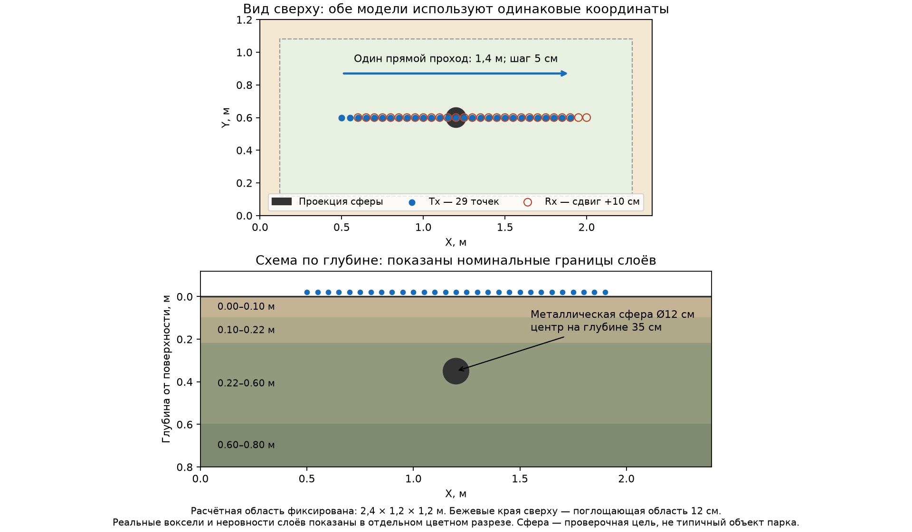
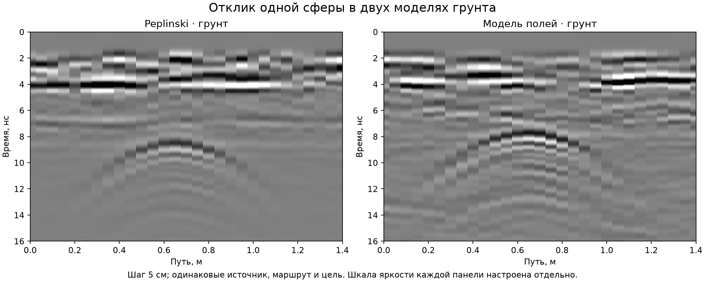
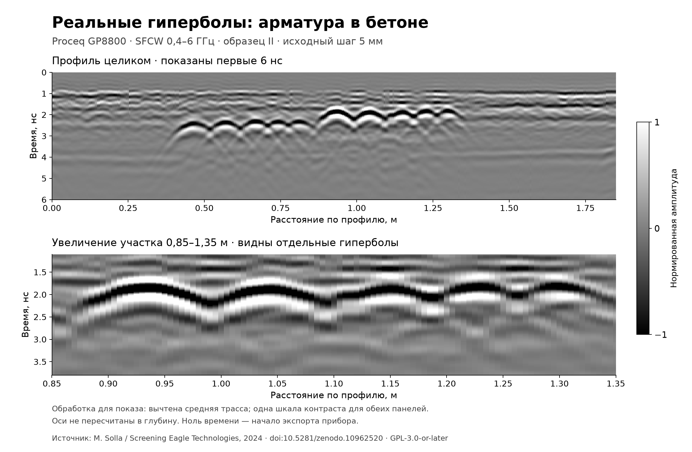
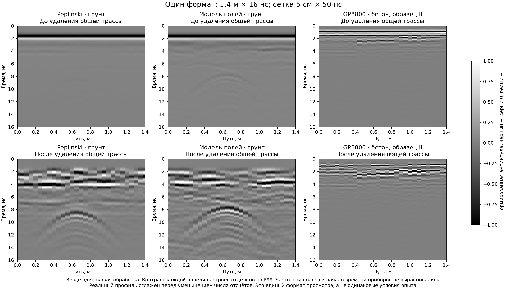

# A- и B-сканы

## Контрольный проход

В сохранённом сравнительном опыте антенна движется по прямой над одной металлической сферой. По 29 положений рассчитано для двух генераторов грунта; источник и геометрия цели одинаковы.

Это завершённый сравнительный опыт. Редактируемый `park-pilot.json` содержит три сферы, поэтому его новый результат будет отличаться.

## Синтетические радарограммы

Показан эффективный отклик в полосе 400–900 МГц с удалением средней трассы. Контраст панелей нормирован отдельно. Горизонтальная ось — путь, вертикальная — время. Вид гипербол зависит от масштаба осей, глубины цели, скорости в среде и полосы сигнала.

## Реальный георадар

Реальные измерения арматуры в бетоне, Proceq GP8800, SFCW. Автор набора — Mercedes Solla; данные SFCW предоставлены Screening Eagle Technologies. [Исходный набор](https://doi.org/10.5281/zenodo.10962520). Для отображения удалена средняя трасса, без дорисовки гипербол.

## Одинаковая сетка отображения

Сравнение приведено к шагу 5 см и 50 пс в окне 1.4 м × 16 нс. Реальный профиль перед прореживанием сглажен. Это сравнение формы отображения: прибор, среда, частотная полоса, временной ноль и амплитудные единицы отличаются. По этой картинке нельзя вывести процент точности симулятора.

Сырой сигнал новых экспериментов хранится в В/м. Картинки используют собственную шкалу контраста и не заменяют численный экспорт. [Как загрузить массивы](../usage/exports.md).
