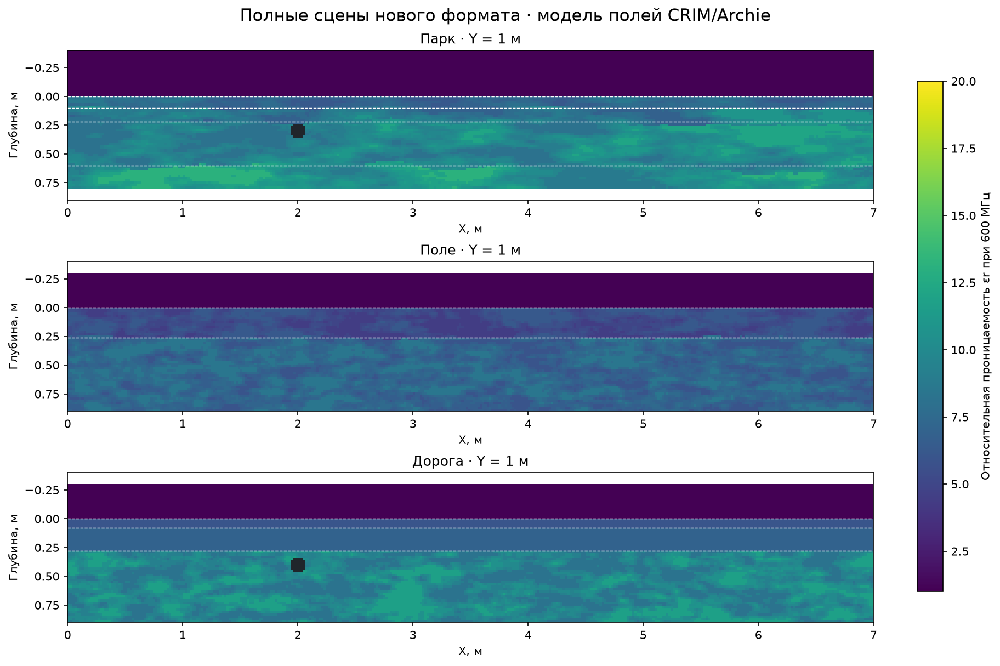
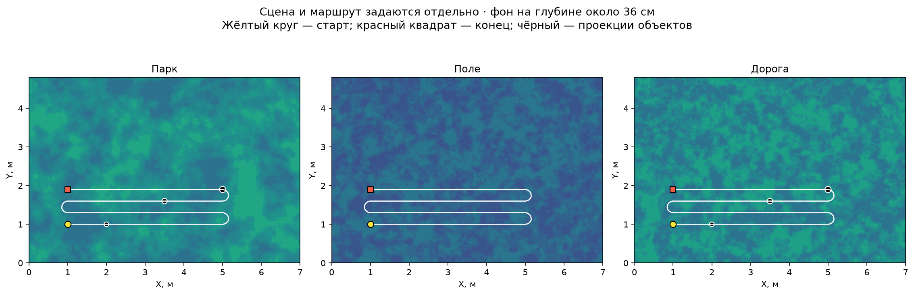

# Парк, поле и дорога

Полные примеры имеют размеры 7 × 4.8 × 1.2 м. Они используют один формат и одни команды; меняются слои, объекты и параметры грунта.

| Файл | Слои | Объекты |
| --- | --- | --- |
| `examples/scenes/park.json` | Четыре минеральных горизонта, общая толщина 0.80 м | Три тестовые сферы |
| `examples/scenes/field.json` | Обрабатываемый верх 0.26 м и нижний слой 0.64 м | Пустая контрольная сцена |
| `examples/scenes/road.json` | Асфальт 0.08 м, основание 0.20 м, грунт 0.62 м | Три тестовые сферы |

Это сценарные толщины, а не универсальное устройство любого парка или дороги. Набор `park-pilot.json` использует такую же четырёхслойную модель парка на меньшей площади.



Здесь показана модель полей CRIM/Archie. Шкала — действительная относительная проницаемость при 600 МГц; чёрное — идеальный металл. Пунктир обозначает номинальные границы, а не отражённую волну.



Жёлтый круг — старт, красный квадрат — конец. Проекции объектов нанесены независимо от глубины горизонтального разреза.

```bash
python geodatagen.py init park-full --scene examples/scenes/park.json --trajectory examples/trajectories/snake.json
python geodatagen.py init field-full --scene examples/scenes/field.json --trajectory examples/trajectories/snake.json
python geodatagen.py init road-full --scene examples/scenes/road.json --trajectory examples/trajectories/snake.json
```

Для Peplinski добавьте `--mode native_peplinski` и выберите новое имя опыта. Для случайной расстановки используйте `park-random.json` либо `park-poisson.json`.

Старые 4500 A-сканов доступны в [архиве v1.0.0](https://github.com/bySaf/geodatagen/releases/tag/v1.0.0). Они рассчитаны по прежним конфигурациям и не являются результатом сцен на этой странице.
