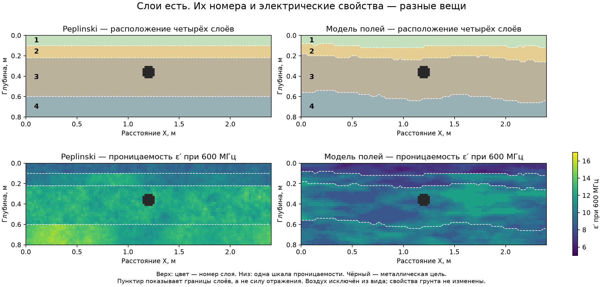

# Модель и ограничения

## Прямой расчёт

GeoDataGen задаёт материалы и положения Tx/Rx, затем gprMax решает уравнения Максвелла методом FDTD. На выходе сохраняется электрическое поле `Ey` в точке приёмника. Это прямая симуляция: реальные сырые записи не передаются в gprMax для превращения в A- или B-сканы. [Warren et al., 2016](https://doi.org/10.1016/j.cpc.2016.08.020).

A-скан — зависимость поля от времени в одной позиции. B-скан — последовательность таких записей. Его горизонтальная ось показывает накопленный путь антенны; на змейке это не одна координата X. Вертикальная ось — время, а перевод в глубину требует модели скорости.

## Неоднородный грунт

Грунт представлен ячейками материалов. Соседние значения связаны пространственной корреляцией: влажное пятно занимает область, а не случайно меняется от ячейки к ячейке. Стратиграфия задаёт крупные слои; случайные поля описывают изменения внутри них.

Штатный Peplinski связывает текстуру, плотность и влажность с электрическими свойствами. Его заявленный диапазон — 0.3–1.3 ГГц. Центральная частота импульса внутри диапазона не означает, что весь спектр находится внутри него. [Peplinski et al., 1995](https://doi.org/10.1109/36.387598).

В модели полей сначала генерируются пористость и водонасыщение. Объёмная влажность равна их произведению. CRIM смешивает диэлектрические вклады фаз, Archie описывает вклад проводимости поровой воды; добавочная поверхностная проводимость задаётся явно. В текущем варианте эта модель недисперсионная. Полученные значения группируются в конечную палитру материалов для FDTD.

Сравнение показывает две разные постановки. Без измерений нельзя считать одну из них более точной.

## Источник и прибор

Источник — идеальный диполь с заданной формой импульса, частотой и токовым моментом. Приёмник — точка измерения поля. Здесь нет корпуса, экранирования, детальной антенны и электроники реального георадара. Для перехода к определённому прибору нужны его геометрия, материалы, возбуждение, приёмный тракт и контрольные измерения.

Эффективный SFCW-отклик строится дополнительной частотной обработкой линейного ответа. Он не является измеренным S21 и не превращает идеальный диполь в калиброванный ступенчато-частотный георадар.

## Границы достоверности

- Сцены — заданные синтетические сценарии, не обследованные участки парка или дороги.
- Движущееся окно исключает дальние отражатели и может менять видимые части гипербол.
- Размер ячейки, PML, временное окно и палитра материалов влияют на результат; для точностной задачи нужна проверка сходимости.
- Шумы электроники, дрейф временного нуля и изменения контакта с поверхностью пока не воспроизводятся как измеренная модель прибора.

Для обучения одометрии важно менять шаг измерений и проверять модель на новых сценах. Постоянный шаг и численные артефакты могут дать ложную точность даже при хорошем совпадении обучающих данных.
